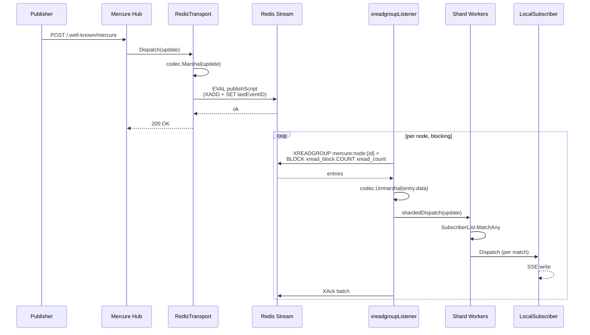
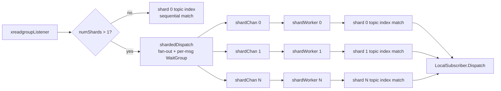
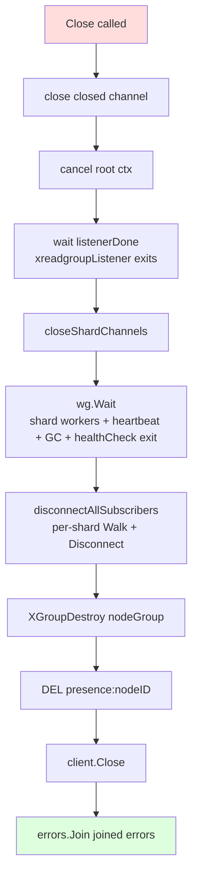
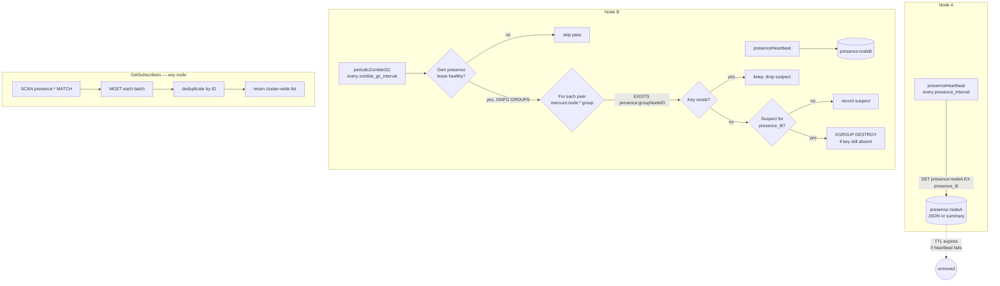

# Redis transport architecture

How the [Redis transport](../README.md) publishes, dispatches and shuts down, how it shares Redis with Caddy storage, and how its codecs compare.

## Architecture

The hot path is a **single per-node consumer group** that reads the shared
stream via XREADGROUP. It fans each entry out to local SSE subscribers,
either on the listener goroutine (default) or on sharded workers
(`dispatch_shards > 1`). Three background goroutines maintain operational
state: presence heartbeat, health PINGs, and zombie-group GC (periodic, or a
single follow-up pass when `zombie_gc_interval` is 0). All delivery,
including to the publishing node's own subscribers, flows through Redis, so
every node sees events in the same server-canonical order.

### Publish and fan-out



The Lua `publishScript` runs XADD then SET atomically: on success,
`Last-Event-ID` is updated to the just-added stream entry's ID (no
phantom IDs). If XADD fails, the SET is skipped. If SET fails after XADD,
`Last-Event-ID` lags behind, but the event is still in the stream and the
next publish updates it. Retention via `XTRIM MINID` can later trim the
referenced entry, which is expected: history replay falls back to a full scan
when the requested ID is missing.

### Sharded dispatch

With `dispatch_shards = 1` (the default), the listener goroutine matches
each update against shard 0's topic index. Subscribers are bucketed by their
exact topic matchers, the wildcard and other matcher types sit in a separate
set, and each candidate is verified with `MatchTopics`.

Above 1, each shard owns its own subscriber list, topic index, channel and
worker goroutine. `xreadgroupListener` fans the update out to all shard
channels and waits on a per-message WaitGroup, so the entry is XACKed only
once every shard has delivered it. Subscribers hash to a stable shard via
xxhash on their UUIDv4 ID, which preserves per-subscriber FIFO ordering.

Neither path takes `t.mu`. Each match snapshots its candidates under the
topic index's read lock, and the listener advances the atomic
`lastDispatchedStreamID` cursor before the fan-out. As a result, a subscriber
added in the meantime is either in the snapshot, or the cursor that
`AddSubscriber` loads already covers the entry.

In the second case, a subscriber that sent
a Last-Event-ID gets the entry from its history replay (at worst it receives
it twice). A subscriber that sent none starts after the entry.



### Shutdown ordering

`Close` ignores its caller's context and runs on its own context with a
fixed 5s timeout. The teardown order is fixed because `xreadgroupListener`
is the only sender into the shard channels. Closing them before it exits
would race a `send-on-closed` panic against an in-flight dispatch.



### Presence and zombie GC

Each node renews `{<stream>}:presence:<nodeID>` with `presence_ttl` on
every `presence_interval` tick. Above `presence_detail_threshold` subscribers
the payload switches to a count-only summary so `SET` payloads stay bounded.
A presence key that expires past its TTL signals a crashed node, and zombie
GC removes its consumer group.

A GC pass follows these rules:

- It never destroys the node's own group.
- It runs only while the node's own presence lease is healthy: the last
  presence write succeeded less than `presence_ttl` ago and no write failed
  within `presence_ttl`. Otherwise the node skips the pass, counts it in
  `mercure_redis_zombie_gc_skipped_total` and logs a warning. A node that
  cannot write its own key cannot tell an expired peer from a Redis that
  refuses writes.
- The first pass that finds a peer's presence key absent only records the
  group as a suspect. A pass at least `presence_ttl` later destroys it with a
  Lua script that checks the presence key again, so a peer that renewed in
  between keeps its group. A peer whose key reappears earlier is dropped from
  the suspects.

With the defaults (`presence_ttl` 60s, `zombie_gc_interval` 5m), a dead
node's group goes on the second pass after its key expires, 5 to 10 minutes
later in steady state. A hub's first periodic pass can come up to two
intervals after it starts, so the bound is longer right after startup.
With `zombie_gc_interval 0`, one follow-up pass runs `presence_ttl` after
startup.

Hubs on v0.1.0 or earlier destroy a group after a single missing presence
key, with no second pass and no lease check. During a rolling upgrade such
a hub can destroy a later hub's group; the later hub recreates it from its
cursor, so the case heals itself.

Run Redis or Valkey with `maxmemory-policy noeviction`, the supported
setting. Under `noeviction` a full server refuses writes; every hub then
fails its presence write and skips GC. Eviction policies (`volatile-*`,
`allkeys-*`) can evict presence keys, which makes live hubs look dead to the
other hubs' GC. The bundled dev Redis and Cluster compose stacks use
`allkeys-lru` on purpose, to exercise the eviction metrics.



`GetSubscribers` scans `{<stream>}:presence:*` and MGETs the values. Glob
characters in the stream name (`*`, `?`, `[`, `]`, `\`) are escaped in the
SCAN pattern. The pattern still matches the keys of a stream named
`<stream>}:presence:<x>`, but those keys are dropped, so only the stream's own
presence keys are read. On Redis Cluster and Ring clients, the SCAN for a
stream name with glob characters goes straight to the node that owns the
stream, without go-redis retries.

The API is **eventually consistent**, with up to one `presence_interval` of
staleness, and may include subscribers from a node that crashed within the
last `presence_ttl`. Build the subscriptions endpoint and debugging on it,
not correctness-critical logic.

**A subscriber leaving while Redis refuses writes.** Removing a subscriber
is local to its node and does not touch Redis, so it succeeds. What fails is
what the node writes afterwards:

- The presence heartbeat. The node's last written entry still lists the
  departed subscriber. Every node's subscription API keeps listing it until
  the node's next successful heartbeat, and at most `presence_ttl` after the
  last successful one. The key then expires, taking all of that node's
  subscribers with it.
- With `subscriptions` enabled, the hub's `active: false` subscription
  update. It is logged at ERROR and not retried, so the stream keeps only the
  `active: true` update. A client that follows subscription events alone
  keeps the subscription active until it reconciles against the
  subscription API, which converges as above.

> **Summary-mode contract caveat.** When a peer node's subscriber count
> crosses `presence_detail_threshold` (default 1 000), that node writes
> a **summary-mode** presence payload containing only the count, without
> the per-subscriber details. `GetSubscribers` materializes a
> `[]*mercure.Subscriber`, which has no representation for "N subscribers
> exist on node X but their details are not available," so the
> aggregated slice silently omits the summary-mode peer's subscribers.
> The aggregate count metric (`mercure_subscribers_connected` scraped
> per instance and summed) is the source of truth for fleet-wide
> subscriber counts. `GetSubscribers` serves the debug and subscriptions
> endpoints, where a single peer above the threshold is uncommon.
>
> If you need cluster-complete enumeration above threshold, raise
> `presence_detail_threshold` (at the cost of larger SET payloads; see
> `mercure_redis_presence_payload_bytes`).

## Sharing Redis with Caddy storage

If you also use [`pberkel/caddy-storage-redis`](https://github.com/pberkel/caddy-storage-redis)
to back Caddy's distributed TLS state, point both at the same server using
shared environment variables. One source of truth for credentials, two
independent connection pools:

```caddyfile
{
    storage redis {
        host {env.REDIS_HOST}
        port 6379
        password {env.REDIS_PASSWORD}
        # tls, db, etc. as needed
    }
}

route /.well-known/mercure {
    mercure {
        transport redis {
            url redis://default:{env.REDIS_PASSWORD}@{env.REDIS_HOST}:6379
            stream mercure
        }
    }
}
```

Each module opens its own pool on purpose. Separate pools isolate lifecycles
(a reload re-provisions each module independently) and failures (ACME backoff
cannot exhaust the transport pool). They also suit different I/O patterns: the
transport runs continuous XADD and XREADGROUP, while storage does sparse
certificate loads.

## Codec choices

`encoding` selects how `mercure.Update` values are serialized onto the
Redis Stream. The transport aliases upstream Mercure's `Codec` interface
and inherits its three implementations.

| Codec | Pick when |
|---|---|
| **`json`** (default) | Most deployments. Human-readable on the wire (`XRANGE` + `redis-cli`). |
| **`msgpack`** | Sustained high throughput or polyglot subscribers. Fastest unmarshal; schema-less. |
| **`gob`** | Almost never. Go-only, slower, and *larger* than JSON in Mercure's usage. Kept for upstream parity. |

### Benchmarks

Apple M4 Pro, a representative Mercure Update (2 topics, UUIDv7 ID,
57-byte JSON data). Regenerate from `redistransport/` with
`go test -run '^$' -bench=Codec -benchmem .`.

Typical payload (≈250 B wire):

| Codec    | Marshal ns/op | Unmarshal ns/op | Wire bytes | Unmarshal allocs |
|----------|--------------:|----------------:|-----------:|-----------------:|
| json     |           330 |            1551 |        254 |               16 |
| msgpack  |           387 |             407 |        217 |                9 |
| gob      |          1632 |            7948 |        300 |              191 |

Large payload (8 KiB data):

| Codec    | Marshal ns/op | Wire bytes |
|----------|--------------:|-----------:|
| msgpack  |          1361 |       8294 |
| gob      |          3358 |       8392 |
| json     |          5327 |       8321 |

JSON is the default because operability beats microseconds at typical
Mercure rates: `XRANGE | grep` during an incident matters. Switch to
MessagePack at sustained ≥10k msg/s per node, with polyglot subscribers,
or when JSON's allocation rate shows up in profiles. Gob is larger than
JSON here because of its per-message type preamble. The compact form needs a
long-lived encoder, which does not fit `Marshal`-per-publish.

### Codec migration

The `encoding` option controls what the dispatcher *writes*. Entries
already in the stream keep their original encoding; subscribers
decode with whichever codec is configured at connect time. A mismatched
codec increments `mercure_redis_stream_decode_errors_total{kind="unmarshal"}`
and drops entries. **All hubs in a fleet must run the
same encoding.**

Cutover procedure:

1. Stop publishers; let consumers ACK to the end.
2. `XTRIM {mercure} MAXLEN 0` (or wait `event_ttl` to expire entries).
3. Change `encoding` fleet-wide; restart.
4. Resume publishers.

Mercure does not version-tag entries, so rolling migration without a
stream clear isn't safe. Schedule a maintenance window.

**Who sets the codec.** Under Caddy the codec is the `encoding` directive, and
the Caddy hub never calls `SetCodec`. `encoding` is part of the key under
which reloads reuse a transport. A reload that changes it gets a new
transport, and one that keeps it reuses a transport with the same codec.

With the Go API, a hub built with `mercure.WithCodec` calls `SetCodec`, which
overrides `WithEncoding` for every later write and read. A transport shared
by several hubs keeps the codec of the last hub that set one, so give them
the same codec.
